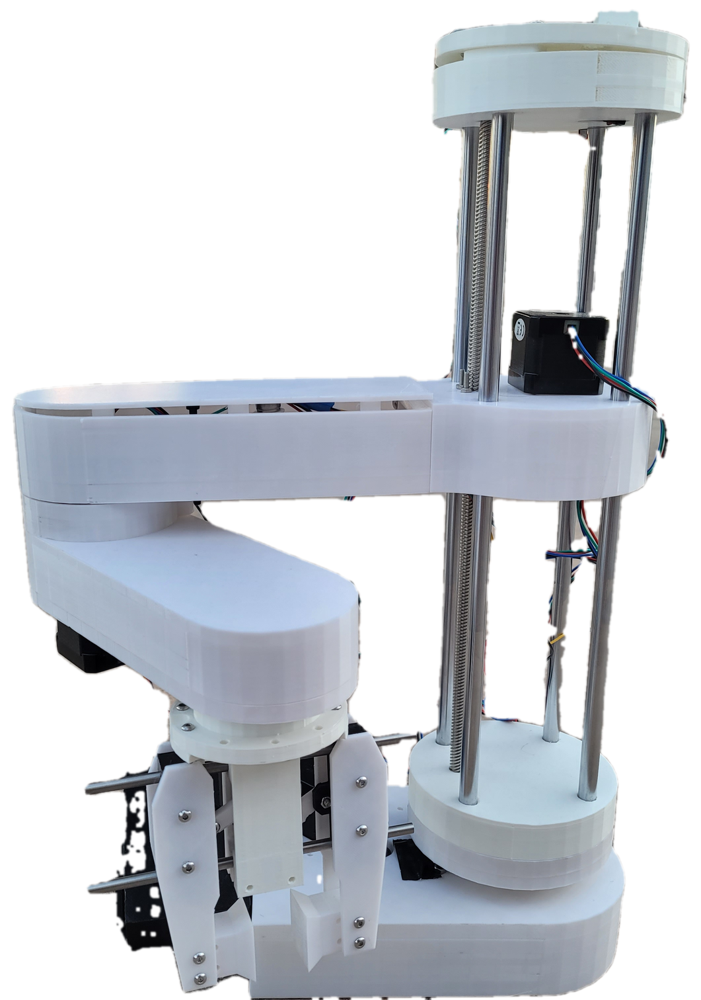
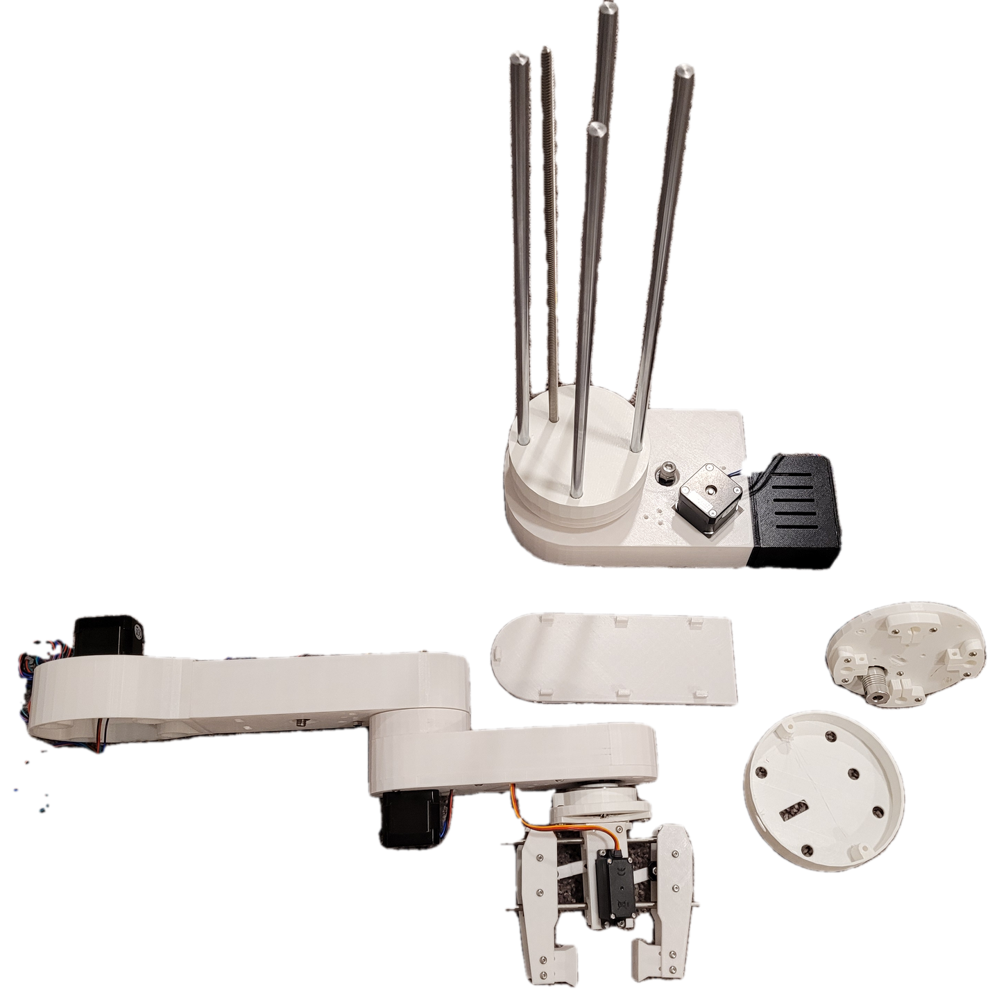
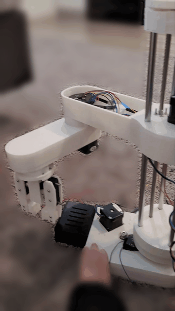
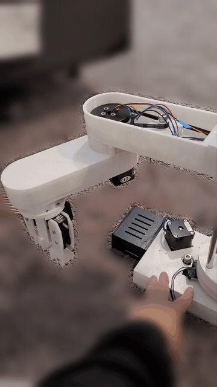
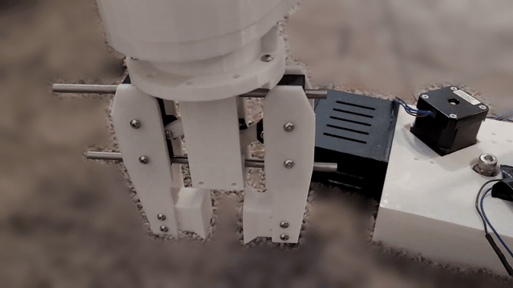

# SCARA Robot Arm

<table>
  <tr>
    <td align="center" width="50%"></td>
    <td align="center" width="50%"></td>
  </tr>
  <tr>
    <td align="center">Finished arm</td>
    <td align="center">Printed parts before assembly</td>
  </tr>
</table>

  
  

  

I built and wired this 4-axis SCARA robot arm from How To Mechatronics' open-source design: [SCARA Robot: How To Build Your Own Arduino Based Robot](https://howtomechatronics.com/projects/scara-robot-how-to-build-your-own-arduino-based-robot/) by Dejan Nedelkovski.

## Result

The arm was fully 3D printed, assembled, wired and **working**: all four axes and the servo gripper move under Arduino control (see the GIFs above).

- **4 degrees of freedom**: two arm joints, wrist rotation and a vertical Z axis on a lead screw with four linear rods
- **Motors**: four NEMA 17 steppers with belt reductions, plus a servo-driven gripper
- **Electronics**: Arduino UNO with a CNC shield and A4988 stepper drivers, on a 12 V supply
- **Build**: every structural part 3D printed in PLA

## Design and code

The design and code belong to How To Mechatronics. This repo only shows my build of it.

- **Build guide**: [How To Mechatronics SCARA tutorial](https://howtomechatronics.com/projects/scara-robot-how-to-build-your-own-arduino-based-robot/)
- **Code** (Arduino firmware and Processing GUI): [SCARA Robot: Arduino and Processing Codes](https://howtomechatronics.com/download/scara-robot-arduino-and-processing-codes/)
- **STL files for printing**: [Cults3D](https://cults3d.com/en/3d-model/various/scara-robot-arm)
